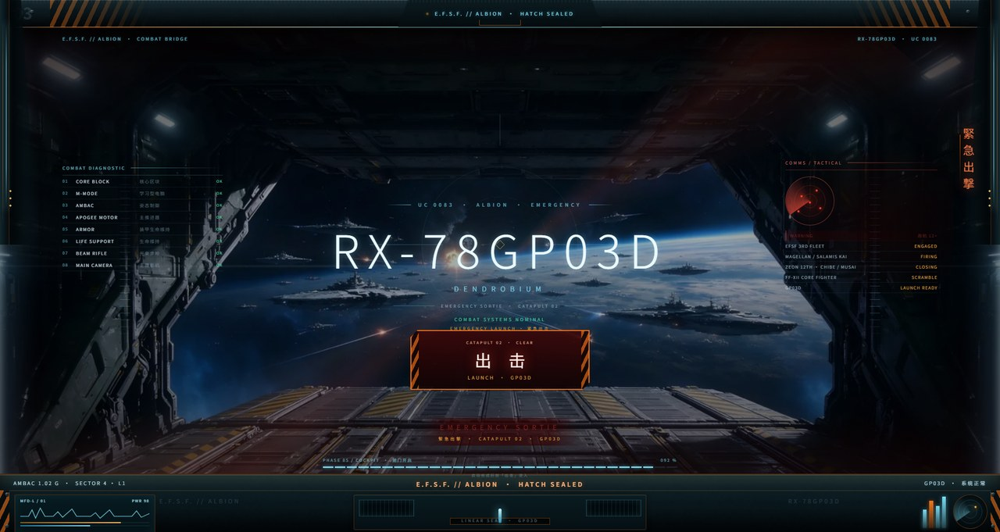
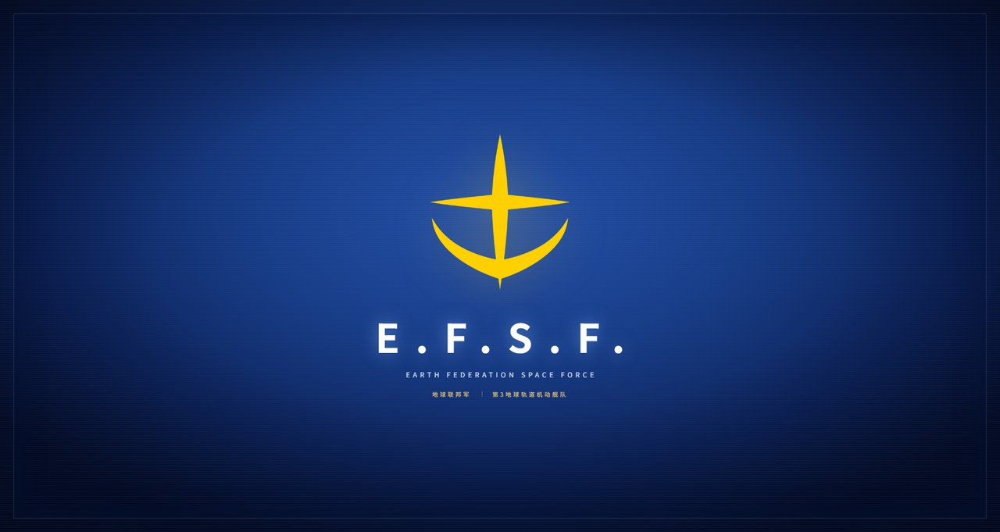

# GUNDAM 0083 HARNESS

**U.C.0083 · RX-78GP03D Dendrobium · Albion panoramic cockpit**

Turns the DeepSeek Harness Web UI into the cockpit of the Albion from *Mobile Suit Gundam 0083: Stardust Memory*: the hangar doors open onto a starfield, the EFSF emblem lights up, seven system checks draw themselves in sequence, and the canopy only seals after the main camera calibrates. What stays is a panoramic canopy frame, a three-section MFD deck, periodic sweeps and pointer parallax.





## Install

**DSH Desktop**: Settings → Plugins → Browse more plugins, search for `GUNDAM 0083` or `dsh-gundam-0083`, then install and refresh the page.

**Command line**:

```sh
dsh plugin --profile web add dsh-gundam-0083
# or straight from GitHub, no build step
dsh plugin --profile web add github:hexuntt/dsh-gundam-0083
```

On DSH Desktop the profile is owned by the app's plugin manager. Install from inside the app; `dsh plugin --profile web` writes to `profiles/web` and will not show up in the desktop app.

## What it does

**Boot sequence (about 28–30 seconds, skippable)**

`CRT ignition → EFSF emblem → boot log → seven system checks → camera calibration → hangar doors → canopy seal → launch`

- Seven checks: POWER → RADAR → WEAPON → AMBAC → LIFE → APOGEE → CAMERA, one spoken line each; each step lights the matching part of the holographic GP03D and draws a targeting box.
- Camera calibration only sharpens: `blur 12 → 7 → 3.2 → 1.2 → 0` in 2.7 seconds, never back out of focus.
- The hangar doors are two stills from the same camera position, revealed by `clip-path` with pneumatic and structural sound.
- Skip with `SKIP` in the top right, `Esc`, or `#noboot` on the URL. The 42-second fallback only fires before the launch screen; the launch screen itself waits for you.

**The standing cockpit**

- Top visor with a sight notch, A-pillars that fade inward, hazard stripes and rivets.
- A three-section instrument deck (left MFD waveform / centre console / right radar) mounted on a real `shell.bottom` layout row, so the composer and approval buttons always stay above it.
- A right-hand situation panel with the GP03D hologram, a fleet list and eight status readouts; it folds away below 1540px and releases its padding.
- Pointer parallax and periodic HUD sweeps. Every decorative layer is `pointer-events: none`.

**Sound**

- All boot SFX are synthesised with WebAudio; no audio files are bundled.
- Local BGM is stored in IndexedDB and resumes after the first click or key press; the console can swap or clear the track.
- Voice uses system TTS with Chinese, English and Japanese lines. `AUTO` prefers Japanese, then Chinese, then English.

**Theme**

- One cold dark theme, applied once on first load; switch away and back from the theme picker afterwards.

**Console**

The `◈ 控制台` drawer at the right of the deck holds the canopy-shade toggle, the situation-panel toggle, boot replay, local BGM, and BGM / VOICE / SFX volume sliders. The settings page adds replay and boot-sound switches.

## Compatibility

- Verified on **DSH 0.2.2-rc.1**; the `0.2.1-rc.2` line is declared compatible too.
- Web and Desktop Web UI only; headless and TUI are untouched.
- Needs WebAudio, `speechSynthesis` and `clip-path` (any current Chrome, Edge or Firefox). Japanese voice requires a ja-JP system voice.

## Privacy

The plugin makes no network requests and reports nothing. BGM, volumes and toggles live in local `localStorage` / IndexedDB. The fleet and status readouts in the situation panel are static local data.

## Development

```text
index.js          host half (only exists so the cordis.patch.yml loader row resolves)
client.js         the whole UI: boot sequence, canopy, deck, situation panel, settings, CSS
cordis.patch.yml  bundle insert patch
locale/*.json     plugin-page title and summary
icon.svg          DSH plugin-page icon
assets/           storefront icon
screenshots/      storefront screenshots (declared in screenshots.json)
```

`client.js` is a hand-written single-file ESM client bundle. After editing, run `node --check client.js` and make sure the file has no BOM.

## Copyright and disclaimer

This is an unofficial fan project, not affiliated with Sotsu, Sunrise, Bandai Namco or DeepSeek. The characters, mobile suits and emblems of *Mobile Suit Gundam* belong to their respective rights holders.

The repository contains no animation, OST, official voice tracks or scanned art books. Boot SFX are synthesised with WebAudio; the mobile-suit line art and hangar stills are fan-made assets. Code is released under MIT; the fan-art image assets are outside that licence, are used only to present this plugin's interface, and must not be sold.

## License

MIT © 2026 hexun
