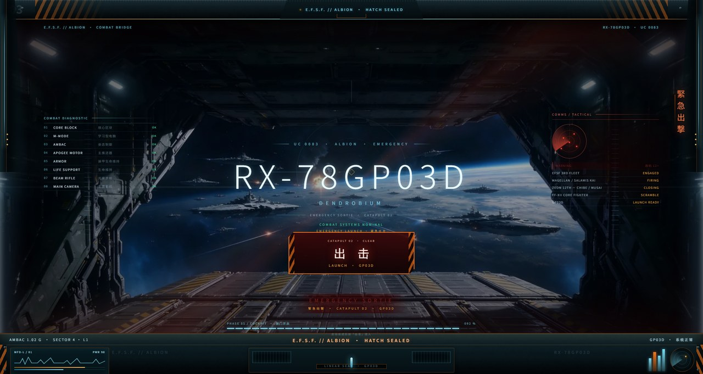
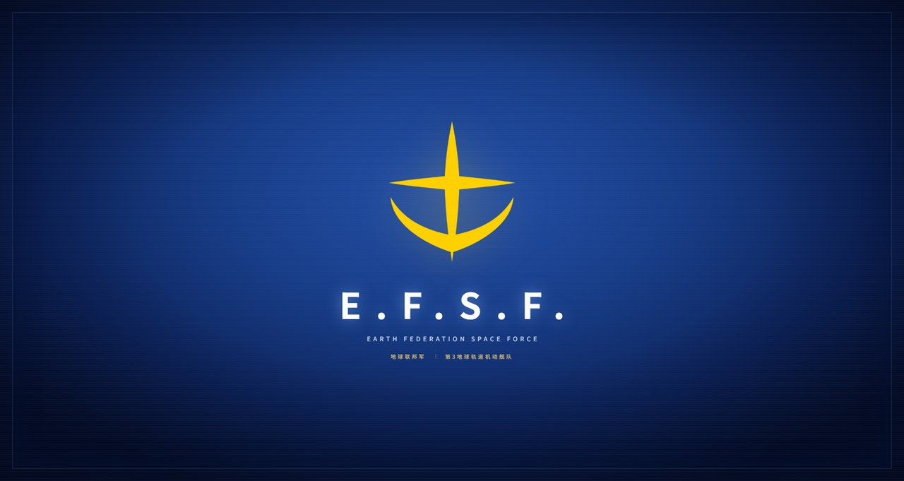

# 高达0083 HARNESS

**U.C.0083 · RX-78GP03D 石斛兰 · 阿鲁比昂号全景座舱**

把 DeepSeek Harness 的 Web UI 变成《机动战士高达 0083：星尘的回忆》里阿鲁比昂号的驾驶舱：舱门在星海中开启，EFSF 徽标亮起，七项机体自检逐段画出，镜头校准完毕才开舱。落座之后，留下的是全景舱框、三段式 MFD 仪表台、周期性扫描与鼠标视差。





## 装上去

**DSH Desktop**：设置 → 插件 → 浏览更多插件，搜索 `GUNDAM 0083` 或 `dsh-gundam-0083`，点安装。装完刷新页面。

**命令行**：

```sh
dsh plugin --profile web add dsh-gundam-0083
# 或者直接从 GitHub 装（无需构建）
dsh plugin --profile web add github:hexuntt/dsh-gundam-0083
```

桌面端的 profile 由应用自己的插件管理器管理；在桌面端请在应用内安装，`dsh plugin --profile web` 装进去的是 `profiles/web`，不会出现在桌面端。

## 它做了什么

**启动序列（约 28–30 秒，可跳过）**

`CRT 启辉 → EFSF 徽标 → BOOT LOG 逐行载入 → 七项自检 → 镜头校准 → 舱门慢开 → 座舱合拢 → 出击`

- 七项自检：POWER → RADAR → WEAPON → AMBAC → LIFE → APOGEE → CAMERA，一项一句播报；中央全息机体会在对应部位亮起瞄准框。
- 镜头校准只降不升：`blur 12 → 7 → 3.2 → 1.2 → 0`，2.7 秒内对到底，不来回失焦。
- 舱门用两张同机位机库图做 `clip-path` 对开，配气动释压与结构声。
- 右上角 `跳过 / SKIP`、`Esc`、或在地址后加 `#noboot` 可跳过；42 秒兜底只在还没到出击画面时触发。出击画面本身会一直停留。

**常驻座舱**

- 顶部带缺口瞄具的遮光梁、左右向内渐隐的 A 柱、危险条纹与铆钉。
- 底部三段式仪表台（左 MFD 波形 / 中央操纵台 / 右雷达）挂在 `shell.bottom` 的真实布局行上，输入框和审批按钮永远在它上方。
- 右侧态势面板：GP03D 全息线稿、舰队列表与八项状态；窗口窄于 1540px 时自动收起并让出位置。
- 鼠标移动带视差，HUD 周期性扫描；所有装饰层 `pointer-events: none`，不挡点击。

**声音**

- 启动音效全部用 WebAudio 现场合成，不打包任何音频文件。
- 本地 BGM 存在 IndexedDB，首次点击/按键后恢复播放；控制台里可以换曲、清除。
- 语音走系统 TTS：中 / 英 / 日三套台词，`AUTO` 优先日语，其次中文，再退英文。

**主题**

- 一套冷调深色主题，首次加载自动应用一次；之后可以在主题里切走再切回来。

**控制台**

底台右侧的 `◈ 控制台` 抽屉里有：座舱遮罩开关、态势面板开关、重播启动序列、本地音乐、BGM / VOICE / SFX 三条音量滑杆。设置页里另有重播与启动音效开关。

## 兼容

- 已在 **DSH 0.2.2-rc.1** 上验证；`0.2.1-rc.2` 同线兼容。
- 只作用于 Web / Desktop 的 Web UI；headless 与 TUI 不受影响。
- 需要浏览器支持 WebAudio、`speechSynthesis` 与 `clip-path`（Chrome / Edge / Firefox 现代版本均可）。日语播报需要系统装有 ja-JP 语音。

## 隐私

插件不发起任何网络请求，不上报任何数据。BGM 与音量、开关状态只写本机 `localStorage` / IndexedDB。态势面板里的舰队与状态是本地静态数据。

## 开发

```text
index.js          宿主半侧入口（只负责让 cordis.patch.yml 的 loader 行解析）
client.js         全部界面：启动序列、座舱框、仪表台、态势面板、设置、CSS
cordis.patch.yml  bundle 插入补丁
locale/*.json     插件页标题与简介
icon.svg          DSH 插件页图标
assets/           市场卡片图标
screenshots/      市场截图（screenshots.json 声明）
```

`client.js` 是手写的单文件 ESM 客户端包，改完跑一次 `node --check client.js`，并确认文件开头没有 BOM。

## 版权与声明

这是非官方同人作品，与创通、日升、万代南梦宫及 DeepSeek 均无隶属关系。《机动战士高达》系列的角色、机体、徽标等 IP 归各自权利人所有。

仓库不包含动画、OST、官方语音或官方设定集扫描件；启动音效为 WebAudio 现场合成，机体线稿与机库画面为同人自制素材。代码以 MIT 许可发布；同人图像素材不在 MIT 许可范围内，仅用于本插件的界面展示，请勿商用。

## License

MIT © 2026 hexun
